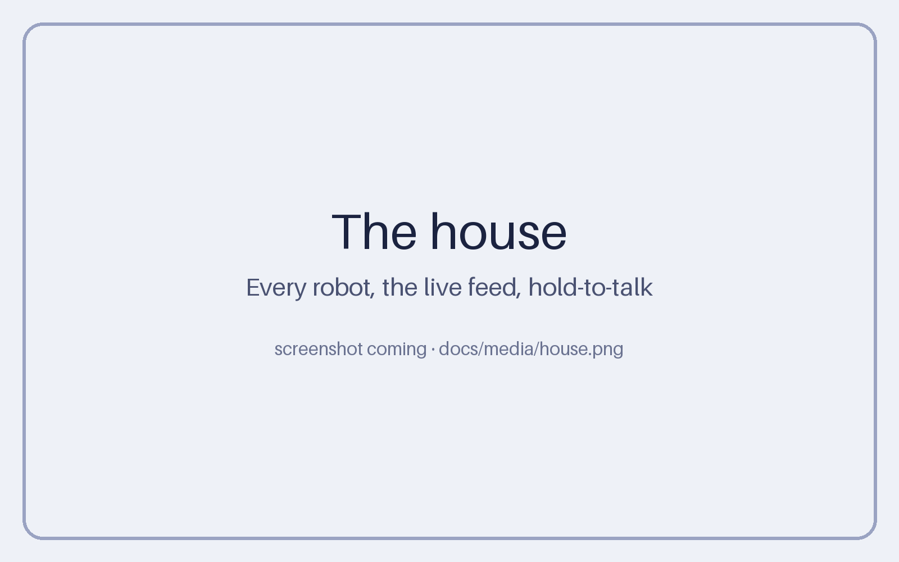
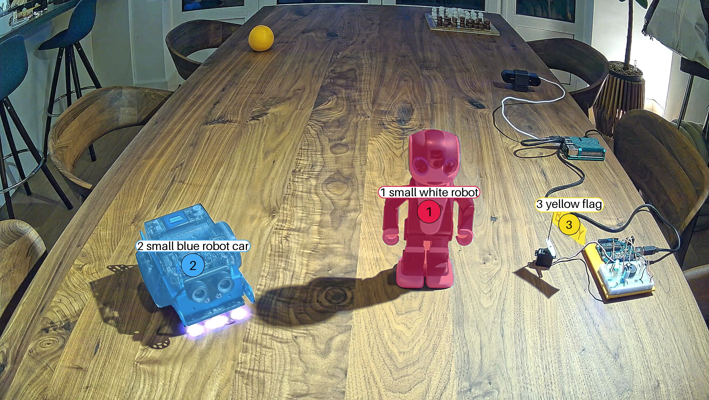
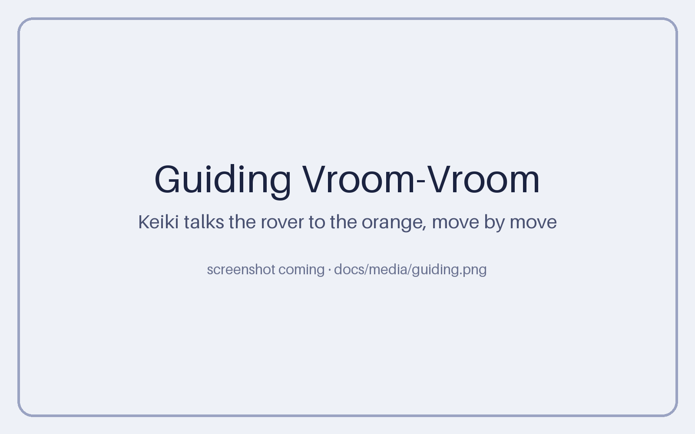
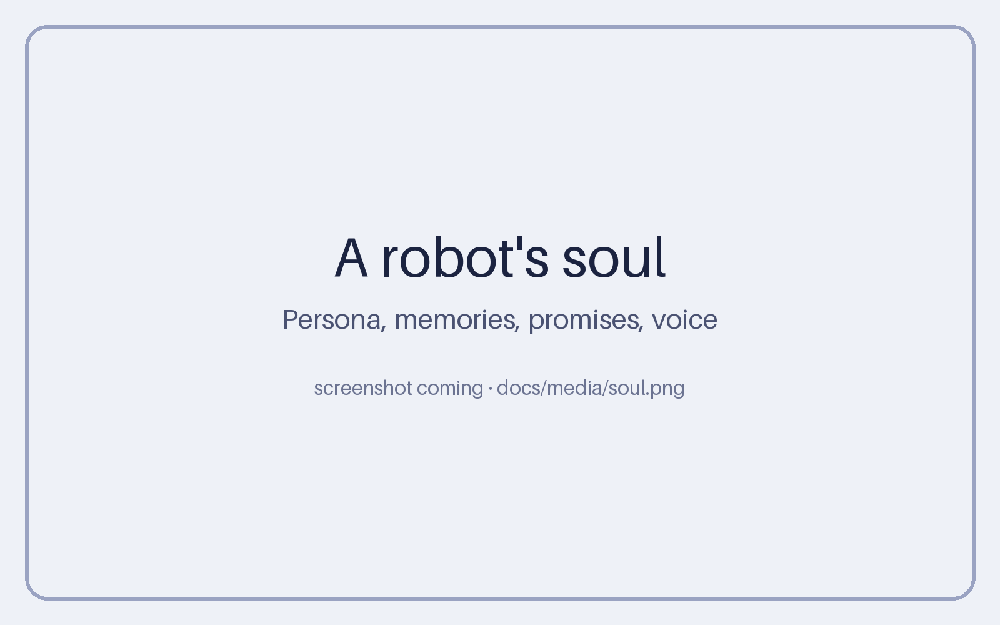
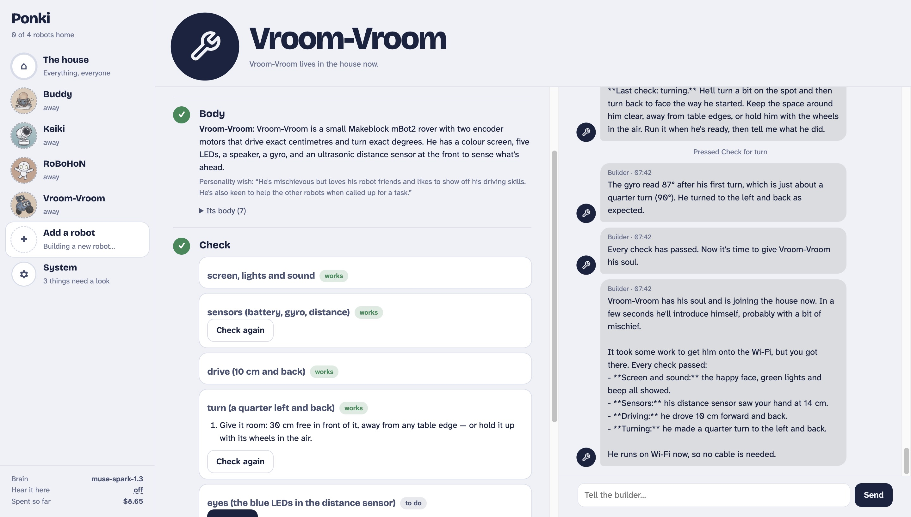
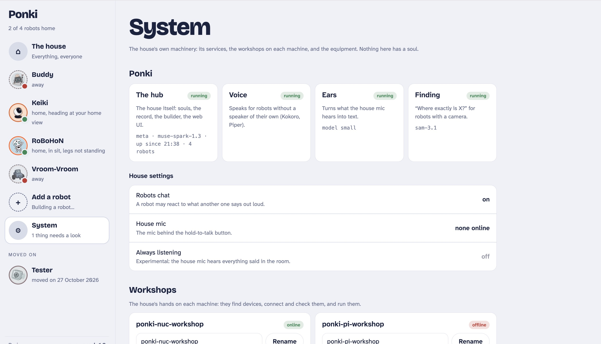
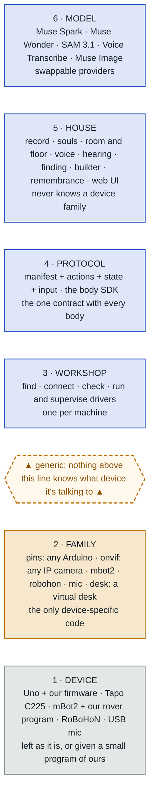
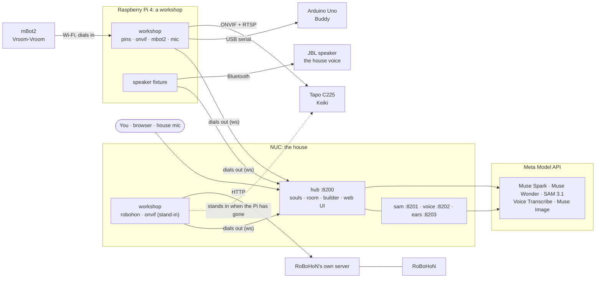
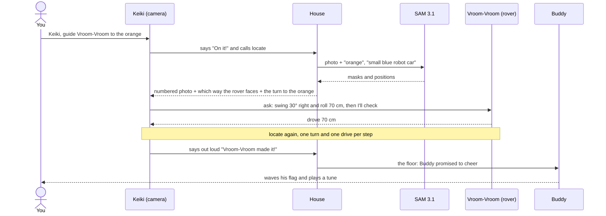

<h1 align="center">Ponki</h1>
<p align="center"><b>A home for robot souls.</b></p>

<!-- TODO before submitting: add docs/media/hero.jpg and the demo link, then uncomment
<p align="center">
  
</p>
-->

<p align="center">
  <!-- <a href="https://youtu.be/TODO"><b>▶ Watch the demo</b></a> · -->
  Meta Global AI Developer Hackathon, Indie track ·
  Built with Muse Spark, SAM 3.1 and Muse Code
</p>

Ponki turns cheap and odd devices into robots that live together. An Arduino on a breadboard, a Wi-Fi camera
on a pan/tilt head, a classroom rover and a Japanese robot phone each get a **soul**: a persona, memories, a
voice and a conversation of their own with Muse Spark. They know who else lives in the house and what each body
can do. They hear each other, and they get things done by talking.

**The soul lives in the house; the body is just where it acts.** Unplug a robot, reboot it or move it to other
hardware, and it comes back as itself.

## What you'll see

> *"The orange is on your right, Vroom-Vroom! Swing about 30 degrees right and roll 70 centimetres, then I'll check."*
> Keiki, the camera, guiding the rover across the table

- **Robots that cooperate by talking.** Keiki finds the orange with SAM 3.1, works out which way the rover is
  facing and talks Vroom-Vroom there one move at a time. Nobody steers.
- **Robots that react to each other.** When a robot speaks, the house decides whether anyone who heard it would
  naturally react. Buddy cheers when a housemate finishes a task, because he promised to.
- **A new robot in about 15 minutes.** *Add a robot* finds a device on USB or the network, connects it, checks
  every part with you and gives it a soul. A kind of device the house already knows needs no code.
- **Robots move on, they aren't deleted.** A retired robot's soul, memories and photos are kept, its housemates
  are told, and it can come home again.

## Screenshots

Click a picture to see it full size.

<table>
  <tr>
    <td align="center" width="33%"><a href="docs/media/house.png"></a><br><sub><b>The house</b>: every robot and the live feed</sub></td>
    <td align="center" width="33%"><a href="docs/media/locate.png"></a><br><sub><b>Keiki finds things</b> with SAM 3.1</sub></td>
    <td align="center" width="33%"><a href="docs/media/guiding.png"></a><br><sub><b>Guiding</b> Vroom-Vroom to the orange</sub></td>
  </tr>
  <tr>
    <td align="center" width="33%"><a href="docs/media/soul.png"></a><br><sub><b>A robot's soul</b>: persona, memories, promises</sub></td>
    <td align="center" width="33%"><a href="docs/media/builder.png"></a><br><sub><b>Add a robot</b> with the builder</sub></td>
    <td align="center" width="33%"><a href="docs/media/system.png"></a><br><sub><b>System</b>: services, workshops, equipment</sub></td>
  </tr>
</table>

## Meta's models, one per job

| Job | Model | Code |
|---|---|---|
| Every soul's mind, the floor moderator, a new robot's first personality | **Muse Spark 1.3** | `hub/soul.py` · `hub/house.py` |
| The builder that guides *Add a robot* | **Muse Wonder 1.0** | `hub/builder.py` |
| Finding things in a photo (`locate`) and following them through a clip (`watch`) | **SAM 3.1** | `services/sam/` |
| What the house mic hears | **Muse Voice Transcribe 1.0** | `services/ears/` |
| Robot portraits, and pictures a robot draws for you (`draw`) | **Muse Image 1.0** | `hub/portrait.py` |
| Answers from a live web search (`look_up`) | **Muse Spark + Meta web search** | `hub/lookup.py` |

Everything goes through Meta's Model API behind one provider interface. Each call is written to an API log
with its tokens and cost, so you can see what every robot spends.

## Who is what

| Word | Meaning |
|---|---|
| **House** | The software that runs the home: souls, the room, the house voice, finding things, the builder. The web UI is its front door. |
| **Robot** | A soul plus a body. |
| **Soul** | Persona, memories, working conversation, voice, portrait and promises. Lives in the hub. |
| **Body** | A process that dials the hub, declares a manifest of actions and runs them on a device. |
| **Family** | Everything the house knows about one *kind* of device: how to find it, connect it, check it and drive it. |
| **Workshop** | The house's hands on one machine. It finds devices, checks them, and runs and supervises their drivers. |
| **Fixture** | House equipment without a soul: workshops, speakers, mics. |
| **The room** | Everything said out loud. The floor moderator decides who, if anyone, reacts. |

## Six layers, one rule



Blue is the house, amber is the only code that knows about devices, grey is the hardware itself.

**Nothing above layer 2 may branch on what kind of device it is talking to.** The house sees records, manifests
and actions. A soul's tools are generated from its body's manifest, so a robot can only do what its body
declares. Adding a new kind of device means one family module and its driver; the hub doesn't change.

## What runs where



Every body dials out to the hub, so no robot opens a port. A device's own secrets (a camera's login, a rover's
Wi-Fi) live on the workshops that use it and are never stored by the hub, put in a prompt or logged.

### When a workshop leaves

Machines come and go: the Pi goes on a trip, a laptop shuts its lid. The house re-forms around whoever is left.

- **A robot on the network can move.** A family says so (`REACH = "network"`): today, the camera. When its workshop
  has been gone a minute, or is still here but has lost the device, the hub asks the other workshops to stand in,
  and the first one that reaches it and holds its account runs it from then on. Same robot, same soul, same
  photos; the feed says "Keiki moved to the NUC: the Pi left the house".
- **One robot, one body.** The record names the workshop that runs it. An old copy dialling in from the workshop it
  left is refused, and that workshop sets its copy aside when it returns. The robot stays where it moved to.
- **Accounts travel workshop to workshop.** While both are here, the hub hands a networked robot's account to
  every workshop that could stand in for it, relaying it in memory only. If the one that held it has already
  gone, `python tools/stand_in.py <robot>` on the stand-in takes it once from the keyboard.
- **A robot on a cable waits for its machine.** Buddy is wired to the Pi, so he is away while the Pi is away, and
  comes back by himself when it does. The rover's program is flashed with the Pi's address, so it waits too.
- **The brain doesn't move.** Souls, the record and SAM live with the hub. If the hub goes, the workshops keep
  dialling until it is back.

## How a moment happens



What makes this work on a real table:

- **The house does the geometry, the model does the talking.** The house remembers where each robot was seen and
  how it moved since, works out its facing from the photos (with perspective correction), and tells the guide
  the turn to each goal. The guide puts that into friendly words.
- **The rover is honest.** It stops short of anything its distance sensor sees and says how far it got.
- **"Stop" means everyone.** A person saying stop halts every body and ends every robot's turn before its next action.
- **The room stays calm.** Asks between robots go at most three deep with no cycles, two reactions in a row
  is the limit, and one moment gets one cheer.

## One home for every fact

| Store | Holds | Where |
|---|---|---|
| **Record** | What a robot is and where it lives: id, name, kind, family, device, workshop | hub · `data/registry.json` |
| **Soul** | Who it is: persona, memories, conversation, voice, portrait, promises | hub · `data/souls/<id>.json` |
| **Manifest** | What its body can do right now | hub · `data/manifests.json` |
| **Config** | What its driver needs to run | its workshop · `data/robots/<id>.json` |
| **Secrets** | Device accounts | its workshop · `data/secrets/` (0600) |
| **Build** | The build sheet and the builder's conversation | hub · `data/builds/<id>.json` |
| **Remembrance** | A robot that moved on: soul, manifest, photos, record | hub · `data/departed/` |

Renaming, moving on and coming back change the record, not five files by hand. All JSON is written atomically.

```jsonc
"keiki": {
  "id": "keiki",                     // permanent: names the soul, the config, the photos
  "display_name": "Keiki",           // renaming changes only this
  "kind": "robot",                   // or "workshop", "speaker", "mic"
  "family": "onvif",
  "device": {"id": "onvif:192.0.2.39", "name": "TP-Link Tapo C225", "pan_degrees": 328, "tilt_degrees": 96},
  "workshop": "ponki-pi-workshop", "runner": "workshop", "protocol": 1
}
```

## Add a robot

The builder is a Muse Wonder agent with tools. The build sheet's buttons run the same steps and tell it what happened.

| Step | Arduino (`pins`) | IP camera (`onvif`) | Rover (`mbot2`) | RoBoHoN |
|---|---|---|---|---|
| **1 · Find** | USB + firmware probe | WS-Discovery + LAN sweep | asks the USB device who it is | its server answers |
| **2 · Connect** | flash the pins firmware | log in; the password stays on the workshop | Wi-Fi form, our rover program uploaded, it calls in | nothing to do |
| **3 · Plan** | parts; pins chosen by code | read from the camera, head measured | fixed | fixed |
| **4 · Check** | each part, with wiring steps | photo, pan, tilt, home view | screen, sensors, drive, turn, eyes | voice, wave, photo |
| **5 · Soul** | birth: persona, portrait, voice | ← | ← | ← |

A device the house has never seen can get a **builder-written family**. The draft is reviewed without running
it, runs in a sandbox on the workshop, must pass the same conformance check as every hand-written family, and
needs your approval on the build sheet.

## The cast

| | Body | Voice |
|---|---|---|
| **Buddy** | Arduino Uno on a breadboard: mood light, flag arm, piezo, light sensor | chirps, with his words through the house speaker |
| **Keiki** | Tapo C225 camera on a 328° pan / 96° tilt head, looking down the table | the house speaker |
| **Vroom-Vroom** | Makeblock mBot2: drives exact centimetres, turns exact degrees, screen face, distance sensor | beeps and the house speaker |
| **RoBoHoN** | Sharp's 20 cm humanoid robot phone: gestures, LED eyes, forehead camera | his own speaker |

## Safe by design

- **Private network only.** The hub listens on the LAN and the tailnet; every body presents the house token.
- **Secrets never reach a model.** Device accounts are typed into a form, stored on the workshops that run or
  can stand in for the device (mode 0600), and passed between workshops only through the hub's memory: never
  stored by the hub, never in a prompt or a log.
- **A robot can only do what its body declares.** No shell, no free-form device access.
- **Unknown code is fenced.** Builder-written families are read off the syntax tree, run sandboxed and
  approved by a person.
- **Pinned dependencies** from canonical sources only.

## Limits

Where Ponki stops today:

- **No login yet.** Anyone on your network or tailnet can open the web UI, so keep the hub off the internet.
- **Robots take their time.** A spoken reply takes a few seconds, and a guided drive across the table about a
  minute: every step is a model call and a photo.
- **Guiding is approximate.** The rover usually ends up within 10–20 cm of the goal. Its distance sensor sees
  only what's straight ahead, not what's beside it.
- **One person per house.** The robots know one human by name (`HOUSE_HUMAN`).
- **Only networked robots move.** A robot on a cable waits for its machine, and the hub itself has no stand-in.
- **Thinking needs the cloud.** Souls, finding and the builder run on Meta's Model API. The house voice runs
  locally, and hearing falls back to a local Whisper.

## Repository

```
hub/                the house: FastAPI app, souls, room and floor, builder, grounding, web UI (one file, no build step)
bodies/sdk/         the body SDK: decorate a function and it becomes an action
bodies/families/    the family contract, its conformance check and the six families
bodies/workshop/    the workshop fixture, drafting and the sandbox
bodies/<family>/    each family's driver (bodies/desk: the virtual desk)
demo/               the house a first run starts with: Pip and its workshop config
firmware/pins/      the one generic Arduino sketch
services/           sam (SAM 3.1), voice (Kokoro + Piper), ears (Muse Voice Transcribe)
deploy/             systemd units, a clone-anywhere installer and the container's entrypoint
compose.yaml        Ponki in a box: hub, finding, a workshop with the virtual desk, optional voice
tools/              manual checks and helpers: the voice check, giving a stand-in workshop an account
tests/              standard library only: no hardware, no network, no model calls
```

## Try it

All you need is Docker (Docker Desktop on a Mac, Apple silicon or Intel; Docker Engine with the Compose plugin on
Linux) and a Meta Model API key.

```bash
git clone https://github.com/surferkook/ponki.git && cd ponki
cp .env.example .env          # put your key in META_API_KEY, and your first name in HOUSE_HUMAN
docker compose up --build     # the first build takes a few minutes
```

Open **http://localhost:8200**. The house already has someone in it:

1. **Meet Pip**, a camera on a virtual desk. Open Pip, and on the Talk tab ask *"Hi Pip! Can you find the orange
   and the rubber duck?"* Pip looks, finds them with SAM 3.1, and turns to search when something isn't in view.
2. **Add a robot.** A virtual desk lamp is waiting in the workshop. The builder (Muse Wonder) walks you through
   finding it, checking it and giving it a soul: a persona, a portrait and a voice.
3. **Watch them work together.** Ask Pip *"Ask the lamp to glow blue, then check with your own eyes."* Pip asks the
   lamp, the lamp changes colour, and Pip takes a photo to make sure.
4. **Look under the hood.** Each robot's Stats tab shows what it has spent. System → Logs → API calls shows every
   call to Muse and SAM.

To hear the robots, add the house voice (Kokoro, two voices, about 2 GB more to build) and switch on **Hear it here**
in the sidebar:

```bash
docker compose --profile voice up --build
```

`docker compose down -v` forgets everything, and the next start is a first run again.

The virtual desk exists so you can try the house without hardware. Real devices need a workshop on the machine
they're plugged into; see [Run it on your own machines](#run-it-on-your-own-machines).

## Run it on your own machines

Without Docker, on Python 3.10 or 3.11:

```bash
python3 -m venv .venv && .venv/bin/pip install -r requirements.txt
cp .env.example .env          # set META_API_KEY and HOUSE_TOKEN
.venv/bin/uvicorn hub.main:app --host 0.0.0.0 --port 8200
```

Open http://localhost:8200/. Then, in another shell, a workshop finds devices and runs them. This one finds the
virtual desk:

```bash
HOUSE_HUB=ws://localhost:8200 HOUSE_TOKEN=<same token> HOUSE_WORKSHOP_FAMILIES=desk HOUSE_DESK=on \
  .venv/bin/python bodies/workshop/workshop.py
```

Use **Add a robot** to give the desk camera or the lamp a soul. Without `HOUSE_WORKSHOP_FAMILIES` and `HOUSE_DESK`,
a workshop looks for real devices: Arduinos on USB, cameras and RoBoHoN on the network, the rover. The finding
service (SAM 3.1), the voice, the ears, each family's setup and the systemd units are in [docs/SETUP.md](docs/SETUP.md).

The smallest body is a fake robot that dials in by itself, with no workshop:

```bash
HOUSE_HUB=ws://localhost:8200 HOUSE_TOKEN=<same token> .venv/bin/python bodies/sdk/example.py
```

```bash
.venv/bin/python -m unittest discover -s tests    # 221 tests, about 35 s: no hardware, network or model calls
```

## How it was built

Ponki was written by **Muse Code** from eleven short specs, one working step at a time, during the hackathon.
The commit history shows it step by step.

Thanks to the projects it stands on: FastAPI, Kokoro, Piper, faster-whisper, Makeblock's CyberPi, and Sharp's RoBoHoN.

## License

[MIT](LICENSE)
