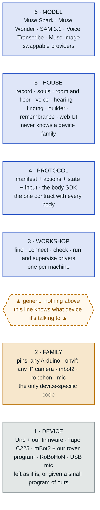
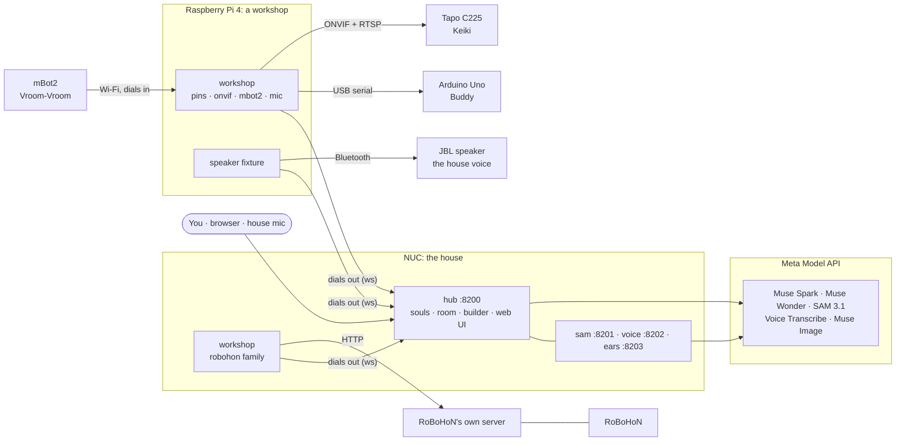
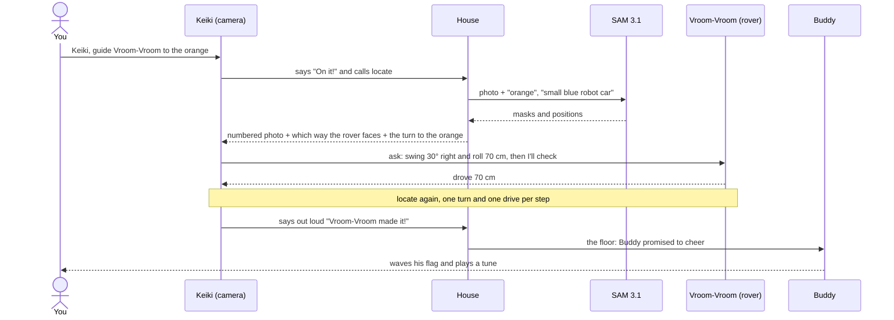

<h1 align="center">Ponki</h1>
<p align="center"><b>A home for robot souls.</b></p>

<!-- TODO before submitting: add docs/media/hero.jpg and the demo link, then uncomment
<p align="center">
  
</p>
-->

<p align="center">
  <!-- <a href="https://youtu.be/TODO"><b>▶ Watch the demo</b></a> · -->
  Meta Global AI Developer Hackathon, Indie track ·
  Built with Muse Spark, SAM 3.1 and Muse Code
</p>

Ponki turns cheap and odd devices into robots that live together. An Arduino on a breadboard, a Wi-Fi camera
on a pan/tilt head, a classroom rover and a Japanese robot phone each get a **soul**: a persona, memories, a
voice and a conversation of their own with Muse Spark. They know who else lives in the house and what each body
can do. They hear each other, and they get things done by talking.

**The soul lives in the house; the body is just where it acts.** Unplug a robot, reboot it or move it to other
hardware, and it comes back as itself.

## What you'll see

> *"The orange is on your right, Vroom-Vroom! Swing about 30 degrees right and roll 70 centimetres, then I'll check."*
> Keiki, the camera, guiding the rover across the table

- **Robots that cooperate by talking.** Keiki finds the orange with SAM 3.1, works out which way the rover is
  facing and talks Vroom-Vroom there one move at a time. Nobody steers.
- **Robots that react to each other.** When a robot speaks, the house decides whether anyone who heard it would
  naturally react. Buddy cheers when a housemate finishes a task, because he promised to.
- **A new robot in about 15 minutes.** *Add a robot* finds a device on USB or the network, connects it, checks
  every part with you and gives it a soul. A kind of device the house already knows needs no code.
- **Robots move on, they aren't deleted.** A retired robot's soul, memories and photos are kept, its housemates
  are told, and it can come home again.

## Meta's models, one per job

| Job | Model | Code |
|---|---|---|
| Every soul's mind, the floor moderator, a new robot's first personality | **Muse Spark 1.3** | `hub/soul.py` · `hub/house.py` |
| The builder that guides *Add a robot* | **Muse Wonder 1.0** | `hub/builder.py` |
| Finding things in a photo (`locate`) and following them through a clip (`watch`) | **SAM 3.1** | `services/sam/` |
| What the house mic hears | **Muse Voice Transcribe 1.0** | `services/ears/` |
| Robot portraits, and pictures a robot draws for you (`draw`) | **Muse Image 1.0** | `hub/portrait.py` |
| Answers from a live web search (`look_up`) | **Muse Spark + Meta web search** | `hub/lookup.py` |

Everything goes through Meta's Model API behind one provider interface. Each call is written to an API log
with its tokens and cost, so you can see what every robot spends.

## Who is what

| Word | Meaning |
|---|---|
| **House** | The software that runs the home: souls, the room, the house voice, finding things, the builder. The web UI is its front door. |
| **Robot** | A soul plus a body. |
| **Soul** | Persona, memories, working conversation, voice, portrait and promises. Lives in the hub. |
| **Body** | A process that dials the hub, declares a manifest of actions and runs them on a device. |
| **Family** | Everything the house knows about one *kind* of device: how to find it, connect it, check it and drive it. |
| **Workshop** | The house's hands on one machine. It finds devices, checks them, and runs and supervises their drivers. |
| **Fixture** | House equipment without a soul: workshops, speakers, mics. |
| **The room** | Everything said out loud. The floor moderator decides who, if anyone, reacts. |

## Six layers, one rule



Blue is the house, amber is the only code that knows about devices, grey is the hardware itself.

**Nothing above layer 2 may branch on what kind of device it is talking to.** The house sees records, manifests
and actions. A soul's tools are generated from its body's manifest, so a robot can only do what its body
declares. Adding a new kind of device means one family module and its driver; the hub doesn't change.

## What runs where



Every body dials out to the hub, so no robot opens a port. A device's own secrets (a camera's login, a rover's
Wi-Fi) stay on the workshop that uses it and never reach the hub, a prompt or a log.

## How a moment happens



What makes this work on a real table:

- **The house does the geometry, the model does the talking.** The house remembers where each robot was seen and
  how it moved since, works out its facing from the photos (with perspective correction), and tells the guide
  the turn to each goal. The guide puts that into friendly words.
- **The rover is honest.** It stops short of anything its distance sensor sees and says how far it got.
- **"Stop" means everyone.** A person saying stop halts every body and ends every robot's turn before its next action.
- **The room stays calm.** Asks between robots go at most three deep with no cycles, two reactions in a row
  is the limit, and one moment gets one cheer.

## One home for every fact

| Store | Holds | Where |
|---|---|---|
| **Record** | What a robot is and where it lives: id, name, kind, family, device, workshop | hub · `data/registry.json` |
| **Soul** | Who it is: persona, memories, conversation, voice, portrait, promises | hub · `data/souls/<id>.json` |
| **Manifest** | What its body can do right now | hub · `data/manifests.json` |
| **Config** | What its driver needs to run | its workshop · `data/robots/<id>.json` |
| **Secrets** | Device accounts | its workshop · `data/secrets/` (0600) |
| **Build** | The build sheet and the builder's conversation | hub · `data/builds/<id>.json` |
| **Remembrance** | A robot that moved on: soul, manifest, photos, record | hub · `data/departed/` |

Renaming, moving on and coming back change the record, not five files by hand. All JSON is written atomically.

```jsonc
"keiki": {
  "id": "keiki",                     // permanent: names the soul, the config, the photos
  "display_name": "Keiki",           // renaming changes only this
  "kind": "robot",                   // or "workshop", "speaker", "mic"
  "family": "onvif",
  "device": {"id": "onvif:192.168.1.39", "name": "TP-Link Tapo C225", "pan_degrees": 328, "tilt_degrees": 96},
  "workshop": "ponki-pi-workshop", "runner": "workshop", "protocol": 1
}
```

## Add a robot

The builder is a Muse Wonder agent with tools. The build sheet's buttons run the same steps and tell it what happened.

| Step | Arduino (`pins`) | IP camera (`onvif`) | Rover (`mbot2`) | RoBoHoN |
|---|---|---|---|---|
| **1 · Find** | USB + firmware probe | WS-Discovery + LAN sweep | asks the USB device who it is | its server answers |
| **2 · Connect** | flash the pins firmware | log in; the password stays on the workshop | Wi-Fi form, our rover program uploaded, it calls in | nothing to do |
| **3 · Plan** | parts; pins chosen by code | read from the camera, head measured | fixed | fixed |
| **4 · Check** | each part, with wiring steps | photo, pan, tilt, home view | screen, sensors, drive, turn, eyes | voice, wave, photo |
| **5 · Soul** | birth: persona, portrait, voice | ← | ← | ← |

A device the house has never seen can get a **builder-written family**. The draft is reviewed without running
it, runs in a sandbox on the workshop, must pass the same conformance check as every hand-written family, and
needs your approval on the build sheet.

## The cast

| | Body | Voice |
|---|---|---|
| **Buddy** | Arduino Uno on a breadboard: mood light, flag arm, piezo, light sensor | chirps, with his words through the house speaker |
| **Keiki** | Tapo C225 camera on a 328° pan / 96° tilt head, looking down the table | the house speaker |
| **Vroom-Vroom** | Makeblock mBot2: drives exact centimetres, turns exact degrees, screen face, distance sensor | beeps and the house speaker |
| **RoBoHoN** | Sharp's 20 cm humanoid robot phone: gestures, LED eyes, forehead camera | his own speaker |

## Safe by design

- **Private network only.** The hub listens on the LAN and the tailnet; every body presents the house token.
- **Secrets never reach a model.** Device accounts are typed into a form, stored on the workshop (mode 0600)
  and kept out of the hub, prompts and logs.
- **A robot can only do what its body declares.** No shell, no free-form device access.
- **Unknown code is fenced.** Builder-written families are read off the syntax tree, run sandboxed and
  approved by a person.
- **Pinned dependencies** from canonical sources only.

## Limits

Where Ponki stops today:

- **No login yet.** Anyone on your network or tailnet can open the web UI, so keep the hub off the internet.
- **Robots take their time.** A spoken reply takes a few seconds, and a guided drive across the table about a
  minute: every step is a model call and a photo.
- **Guiding is approximate.** The rover usually ends up within 10–20 cm of the goal. Its distance sensor sees
  only what's straight ahead, not what's beside it.
- **One person per house.** The robots know one human by name (`HOUSE_HUMAN`).
- **Thinking needs the cloud.** Souls, finding and the builder run on Meta's Model API. The house voice runs
  locally, and hearing falls back to a local Whisper.

## Repository

```
hub/                the house: FastAPI app, souls, room and floor, builder, grounding, web UI (one file, no build step)
bodies/sdk/         the body SDK: decorate a function and it becomes an action
bodies/families/    the family contract, its conformance check and the five families
bodies/workshop/    the workshop fixture, drafting and the sandbox
bodies/<family>/    each family's driver
firmware/pins/      the one generic Arduino sketch
services/           sam (SAM 3.1), voice (Kokoro + Piper), ears (Muse Voice Transcribe)
deploy/             systemd units and a clone-anywhere installer
tests/              standard library only: no hardware, no network, no model calls
```

## Run it

```bash
python3 -m venv .venv && .venv/bin/pip install -r requirements.txt
cp .env.example .env          # set HOUSE_TOKEN and META_API_KEY
.venv/bin/uvicorn hub.main:app --host 0.0.0.0 --port 8200

# in another shell: a fake robot dials in
HOUSE_HUB=ws://localhost:8200 HOUSE_TOKEN=<same token> .venv/bin/python bodies/sdk/example.py
```

Open http://localhost:8200/. The fake robot appears on the board; talk to it, or fire its actions from the Body tab.
The voice, ears, finding service, workshops and each device are set up in [docs/SETUP.md](docs/SETUP.md).

```bash
.venv/bin/python -m unittest discover -s tests    # 202 tests, about 35 s
```

## How it was built

Ponki was written by **Muse Code** from eleven short specs, one working step at a time, during the hackathon.
The commit history shows it step by step.

Thanks to the projects it stands on: FastAPI, Kokoro, Piper, faster-whisper, Makeblock's CyberPi, and Sharp's RoBoHoN.

## License

[MIT](LICENSE)
